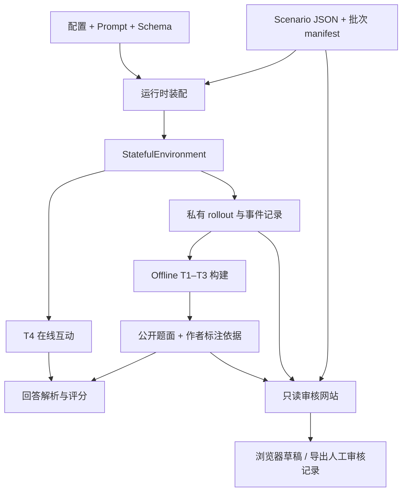

# SocialFlux Architecture

本文说明截至 2026-10-10 的代码职责、入口与产物边界。研究约束以 [DESIGN_CONTRACT](../../DESIGN_CONTRACT.md) 为准，执行顺序见 [Pipeline](PIPELINE.md)，批次状态见 [活跃批次手册](../operations/ACTIVE_BATCH_PIPELINE.md)。

## 一条数据主线，三个使用出口



Gate 与来源哈希控制数据能否进入正式阶段。图中的开发构建不代表通过了正式 Gate；公开题面、作者依据和人工标签分别保存，模型 state 不能自动变为 human GT。

## 模块职责与依赖方向

| 层 | 主要 owner | 职责与边界 |
|---|---|---|
| 公共入口 | `pipeline/cli.py` | 命令解析与分发；不实现状态语义或评分 |
| 批次与实验编排 | `scripts/` | 选择来源、断点恢复、调用领域模块、写 manifest；脚本间仍有已记录的批次依赖 |
| 运行时装配 | `pipeline/runtime.py`、`environment/factory.py` | 按配置装配 provider、policy、appraiser、response generator |
| 状态环境 | `environment/env.py` | 单轮生命周期、restore/snapshot、回应、事件与终止；统一维护环境状态 |
| 判断与数值更新 | `environment/*appraisal*.py`、`state_updater.py`、`calibration.py` | 私有证据判断与确定性数值更新；具体实现由配置决定 |
| 对话与记忆 | `environment/response_generator.py`、`interaction_ledger.py`、`observation.py` | 生成自然回应、记录事件、构造下一轮公开 observation |
| 被测行动 | `policies/model_policy.py` | 自由文本行动与行动校验，不能读取环境角色私有 state |
| 模型传输 | `providers/` | 路由、结构化调用、重试、用量和传输适配；领域模块不直接发送 HTTP |
| 轨迹与分支 | `rollout/runner.py`、`rollout/counterfactual.py` | 自然轨迹；从同一真实 checkpoint 生成候选行动分支 |
| 新版离线构建 | `offline/choice_builder.py`、`choice_media.py`、`choice_audit.py` | 复用来源、题目组装、配对素材、可读导出和诊断 |
| 任务协议 | `tasks/offline_choice.py`、`tasks/T1`–`T4` | 公开投影、输入/输出合同与版本分发；旧概率协议用于已有资产复现 |
| 评分与 Gate | `evaluation/`、`annotation/` | 答案、证据与错误分析；环境、轨迹和任务质量门；人工审核合同 |
| 场景与语义 | `scenario_design/`、`schemas/`、`shared/` | 场景修订、结构校验、四维 state 语义 |
| 网站 | `web/server.py`、`live_rollouts.py`、`offline_review.py` | 只读读取固定来源并提供审核视图，浏览器保存草稿；不构造第二套环境 |

`tasks/T2/runtime.py` 是旧 T2 构造共用运行服务的 owner。各任务和历史脚本直接导入它；原 `scripts/t2_common.py` 转发层已撤除。任务包不应反向依赖 CLI 脚本。仍由 `scripts/scenario_docs.py` 提供的场景文档/发现工具是现有复用边界，本轮没有移动或复制它。

## 环境调用顺序

```text
policy 读取公开 observation → 自由文本 action
→ 私有 appraisal（按配置合并或拆分 state / interaction 判断）
→ Python 校验、校准与数值更新
→ 独立的 response generation
→ ledger / 公开事件 / 非语言触发 / 下一轮 observation
→ 保存私有日志与可恢复 snapshot
```

当前 GPT50 来源使用的 `UnifiedEnvironmentFactory` 以及其他已版本化 appraiser 仍装配到相同的 `StatefulEnvironment` 生命周期。`ModelEnvironmentFactory` 是通用装配入口；不能把当前全部实验描述为只有一个固定 appraisal prompt 或只有一种 API 传输。

四类动态 state 的内部路径为 `emotion`、`behavioral_disposition`、`relationship`、`consequence_risk`。Persona 是稳定私有信息，Dynamics 是独立的外部互动条件。人物方向、变量定义及证据判断沿用已有合同；整理目录不改变这些语义。

每个批准场景只有一个自然 rollout slot，不做 best-of-N。自然结束与长度门由所选批次规则处理；失败、短轨迹、中断和重试保留为产率及诊断证据，不能通过清理文件消失。

## 三类离线能力

| 任务 | 输入 | 作者侧依据 |
|---|---|---|
| T1 状态理解 | 已发生的历史、明确 checkpoint 或区间 | 源轨迹 state、事件、公开证据及人工判断 |
| T2 历史依赖 | 共享背景、不同 History A/B、相同 ending | 改写位置、来源哈希、受控回放及人工判断 |
| T3 后果预测 | 行动前历史、2–4 个候选行动 | 同一 snapshot 与外部条件上的分支；即时为下一次环境回应，延迟 5 轮，必要时最多 10 轮 |

当前开发协议为 `socialflux_offline_choice_v1`，主回答只需 `{"answer":"B"}`。`public_instance()` 使用白名单产生模型输入，能力标签、state 路径、错项类型、参考答案与未来分支留在作者侧。证据定位单独诊断；组合选项保存变量映射，分维诊断不混入整题成绩。完整定义见[选择题协议](../protocols/OFFLINE_T1_T3_CHOICE_V1.md)。

T2 制作阶段可以调用 provider 进行状态与互动回放；offline 指被测模型回答固定材料，不意味着制作阶段没有 API。强制相同 ending 是构造控制，不等于两边的自然性已经通过人工审核。

## 配置与数据分层

- **入口配置**：`configs/offline_choice_dev60.json` 明确指定当前题库来源与输出；GPT50、Claude150 和 T4 各有批次配置，见[配置索引](../../configs/README.md)。
- **通用正式默认值**：`pipeline/constants.py` 仍保留 Fable 基线默认值。不能用该默认值推断 GPT 开发批次的实际模型；本轮未切换配置。
- **固定指令**：`prompts/manifest.json` 注册 50 份可调用模板并校验哈希。已删除 39 份中间实验稿，`retired.json` 只记录其 ID 与原 SHA；[运行时目录](../prompts/RUNTIME_PROMPT_CATALOG.md)区分当前链路和仍有调用方的兼容入口。
- **结构与语义合同**：`schemas/`、`environment/state_ontology.py`、`shared/STATE_ONTOLOGY_v2.md` 与相应协议共同约束数据；更改须显式版本化。
- **批次产物**：`data/` 保存场景、私有轨迹、公开题目、视频、调用记录和审核来源。`build/` 同时含可重建检查结果、不可随意丢弃的实验结果和 `web-service` 运行环境，不能整目录当缓存清空。
- **结论与历史**：`reports/` 保存方法与失败证据，`docs/source-notes/` 保存设计输入，`archives/` 保存不参与默认加载的恢复副本。

当前题库在 `data/offline_t1_t3_dev60/`：`items.jsonl` 为完整 60 题设计包，`public.jsonl` 为公开投影，`replay_ready.items.jsonl` 为 56 题可回放开发子集；`sources/` 保存构造来源，`paired.*` 和 `media.json` 保存 text/video 配对。网页直接读取这些文件，避免再维护一份题库。

## 网站与人工标注

`web/server.py` 的 `PAGE_ROUTES` 统一声明当前页面；`LEGACY_PAGE_ALIASES` 仅保留旧书签映射。当前入口为 `/gpt50`、`/gpt50-live`、`/offline-review`、`/multimodal`、`/state-annotation`。旧示例页 `task_examples.html` 仍可直接访问，因此其 `styles.css` 继续保留。

新版题目页默认请求公开题目，按需通过独立 reference 接口获取私有 state、构造来源和未来分支。来源文件须匹配题目记录的 SHA；不传原始 provider 请求、调用日志或环境快照。视频同时检查题目配对、文件哈希和历史位置。

标注草稿保存在浏览器 localStorage，导出绑定题库 SHA、逐题 SHA、标注人、可接受答案、证据、质量判断及是否查看过参考。网站不调用模型、不写正式 GT，也不自动批准来源 Gate。详细操作见[网站说明](../../web/README.md)。

## 维护与清理

判断文件是否可删除，应同时检查：代码导入、CLI/网页入口、配置与 prompt manifest、实验/报告引用，以及是否是运行服务或未提交工作。文件名包含 `old`、`candidate`、版本号或 `.orig` 不能单独作为删除理由。

本轮清理：

- 删除已被路由替代的 `web/static/index.html`、`review.html`、`scale150.html`、`scale300_tasks.html`、`t2_dev_review.html` 和专用 `app.js`；旧 URL 保留兼容。
- 17 个仓库调用方直接导入 `tasks.T2.runtime`，删除无调用方的 `scripts/t2_common.py`。
- 仅清理源码目录的 Python 生成缓存；不清空 data、build、服务环境或实验记录。
- 更新网站测试为隔离的临时场景来源，避免依赖已移除的 20 个旧场景；保留公开/私有边界、来源哈希、缺失来源和旧 URL 的检查。
- 按确认的 prompt 链删除 39 份被替代模板，撤下注册并清理其文本测试；保留模板正文未变。引用旧模板的历史配置会明确报错，不自动换版本。删除依据和恢复记录见 [Prompt 审计](../prompts/PROMPT_AUDIT.md)。

删除前的文件副本、SHA 和清单保存在 `archives/cleanup-2026-10-10/`。`before_cleanup.tar.gz` 同时保存修改前的相关文件；恢复应先核对路径和当前差异，按需提取单个文件，避免覆盖后续工作。验证记录在 `build/architecture_cleanup_20261010/`。

继续保留 `prompts/manifest.json.orig`（冻结批次依赖）、历史配置、实验报告及失败产物；保留共享 CSS 和仍可调用的旧任务协议。已有实验报告的代码哈希描述当时实现，本轮重构不回写旧哈希；新运行应生成新的实现指纹。
